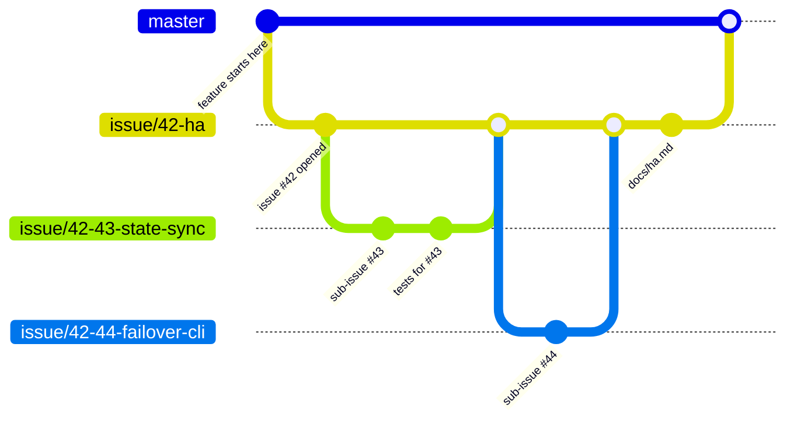
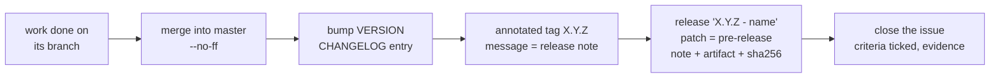

# prisma-web - Project Rules

## TL;DR

Every feature gets an issue. Every issue gets a branch. Every branch carries
its documentation, and everything this project writes down — documentation,
user-facing strings, source comments and anything posted on the tracker — is
in Brazilian Portuguese (pt-BR), opens with a TL;DR, uses RFC 2119 keywords for anything
normative, answers 5W2H, and draws its diagrams in Mermaid. A feature too
large for one issue is split into sub-issues, whose branches are cut from the
parent issue's branch, not from `master`. Every merge into `master` is a
release: a version bump, an annotated tag, a changelog entry and a published
release.

The key words **MUST**, **MUST NOT**, **REQUIRED**, **SHALL**, **SHALL NOT**,
**SHOULD**, **SHOULD NOT**, **RECOMMENDED**, **MAY** and **OPTIONAL** in this
document are to be interpreted as described in [RFC 2119][rfc2119].

[rfc2119]: https://www.rfc-editor.org/rfc/rfc2119

## 5W2H

| | |
|---|---|
| **What** | The rules for documentation, issues, branches and releases in this repository. |
| **Why** | Work that is not written down cannot be reviewed, audited or handed over, and a change with no issue behind it has no recorded reason for existing. |
| **Who** | Everyone who commits to this repository, human or agent. |
| **Where** | This repository and its issue tracker. |
| **When** | Before the first commit of any change, not after it. |
| **How** | One issue per feature, one branch per issue, sub-issue branches cut from the parent branch, and documentation merged in the same branch as the code it describes. |
| **How much** | One issue and one branch per feature. Documentation is proportional to the change: a new subsystem earns a page under `docs/`, a bug fix earns a commit message that explains the failure. |

## 1. Documentation

These rules apply to every document under `docs/`, every `README.md`, every
`*.md` in this repository, **and to everything the project writes on the
tracker**: issue bodies, comments, pull request descriptions, release notes
and tag messages. Tracker text is documentation that lives outside the tree:
an issue is where the reason for a change is recorded, and it is read years
later by someone deciding whether a behaviour was deliberate. An issue that
says "it should probably reject overlapping ranges" leaves that reader
guessing whether it was a requirement or a musing; **MUST** and **SHOULD**
settle it.

| # | Rule | Notes |
|---|------|-------|
| 1 | Documentation MUST be written in **Brazilian Portuguese (pt-BR)** | Including user-facing strings, CLI syntax, generated files **and source comments**. Any exception MUST be listed by name, and enforced by a check, so it cannot quietly grow. |
| 2 | Every document MUST open with a **TL;DR** | Three to six lines. A reader who stops there MUST still know what the document is about and what it decided. |
| 3 | Every document MUST answer **5W2H** | What, Why, Who, Where, When, How, How much. A table is RECOMMENDED. Short documents MAY fold it into prose, but no question may go unanswered. |
| 4 | Normative statements MUST use **RFC 2119** keywords | "The pool MUST reject overlapping prefixes", not "the pool should probably reject". Every document that uses the keywords MUST cite RFC 2119. |
| 5 | Diagrams, when needed, MUST be **Mermaid** | Inline in the Markdown. No binary images, no external diagram services, no ASCII art — a diagram that cannot be diffed cannot be reviewed. Diagrams are OPTIONAL; one that only restates the prose SHOULD be dropped. |

Where each rule binds:

| | `docs/`, `README`, `*.md` | Issues, comments, PRs, tag messages |
|---|---|---|
| Language | MUST | MUST |
| RFC 2119 for normative statements | MUST | MUST |
| TL;DR | MUST | SHOULD, for anything longer than a screen |
| 5W2H | MUST | SHOULD, on the issue body; not on comments |
| Mermaid for diagrams | MUST | MUST |

A document that describes a decision SHOULD state what was rejected and why.
The reason a knob exists is worth more than the knob's name.

**Never invent the output of a command.** Quote only output that was actually
produced; where possible, from a test that asserts it.

**The README is the landing page**, and for most readers the only one. Every
task MUST end by asking whether it made the README wrong, and the answer goes
on the issue. A README rarely says something false on the day it is written;
it goes stale by describing a smaller product than the one that now exists.

### Markdown conventions

* Tables when there are **three or more comparable items**; never for running
  prose. A reference table has a column that answers "what does this do for
  me?", not just the field's name.
* Every command goes in a fenced code block.
* A diagram only when there is a decision, an order or a topology. If the boxes
  have no arrows that mean something, a list was the right format.
* Bold is for the one phrase a skimming reader must not miss, not decoration.

## 2. Issues

Every feature MUST have an issue, opened **before** the work starts.

An issue MUST contain:

* **What** the feature does, in one paragraph.
* **Why** it is needed — the operational problem, not the implementation.
* **Acceptance criteria**, as a checklist someone else can verify without
  asking the author.
* **How it will be tested.** "Tested manually" is not acceptable; name the
  suite, lab or script that will assert the behaviour.

An issue MUST be kept current. When the design changes mid-flight, the issue
is edited or commented; the divergence MUST NOT live only in the branch. An
issue MUST NOT be closed until its documentation is merged.

### The issue is the record of the work

The issue — not the commit message, not the pull request, not a chat — is
where someone looks a year later to find out what was decided and why. So the
work MUST be written back to it as it happens:

* **A design decision the issue did not anticipate** MUST be added as a
  comment, with the reasoning and what was rejected.
* **A measurement** MUST be recorded on the issue, with its conditions. A
  number in a terminal that scrolled away was not measured.
* **A refusal or a limit** MUST be stated: what the change deliberately does
  not do, and what would be needed to do it. A limit discovered later, by a
  reader who assumed otherwise, costs far more than the sentence that would
  have prevented it.
* **Anything found on the way that is not this issue** MUST become its own
  issue, linked from this one, rather than a paragraph nobody will find.
* **Closing** MUST carry the acceptance criteria, ticked, with the evidence
  for each — and the release it shipped in.

An issue closed with "done" is an issue whose reasoning was thrown away.

Bug fixes, refactors and chores SHOULD also get an issue. They MAY go straight
to a fix branch when the change is smaller than the issue describing it would
be — a typo, a missing dependency — but anything that changes behaviour MUST
go through an issue.

### Sub-issues

A feature that does not fit in one reviewable change MUST be split into
sub-issues. Each sub-issue is a real issue by the rules above and MUST link
back to its parent. The parent MUST list its children and MUST NOT be closed
while any child is open.

## 3. Branches

| Kind | Branch name | Cut from | Merges into |
|---|---|---|---|
| Issue | `issue/<number>-<short-slug>` | `master` | `master` |
| Sub-issue | `issue/<parent>-<child>-<short-slug>` | the **parent issue branch** | the parent issue branch |
| Trivial fix | `fix/<short-slug>` | `master` | `master` |

* Every issue MUST have its own branch. Two issues MUST NOT share one.
* A sub-issue branch MUST be cut from its parent's branch and MUST merge back
  into it. It MUST NOT merge into `master` directly — `master` sees the parent
  feature whole, or not at all.
* A branch MUST NOT be merged while its tests fail or its documentation is
  missing.
* `master` MUST always build and MUST always pass the test suite.
* Branches SHOULD be deleted once merged.



## 4. Definition of done

A branch is ready to merge when **all** of the following hold:

1. The issue's acceptance criteria are met.
2. The change carries a test that **fails without it**. A test that cannot
   fail is not a test — and an artifact that declares success without
   verifying the effect is the defect class this rule exists for.
3. The test suite passes, and any integration suite the change touches passes.
4. The documentation required by section 1 is merged in the same branch.
5. The commit message explains the failure or the decision, not the diff. The
   diff is already in the commit.

## 5. Versioning and releases

`VERSION` is the single source of truth; no version string is hardcoded
anywhere else. The project stays on `0.x.y` until the maintainer declares it
production-ready — `1.0.0` is a decision, not a milestone reached by counting
features. **A major version MUST NOT be made** until the maintainer says so:
only minor and patch bumps are allowed.

| Change merged into `master` | Bump | Published as |
|---|---|---|
| A feature issue, or a parent issue with its sub-issues | `0.MINOR.0` | **release** |
| A fix, a chore, a documentation-only change | `0.x.PATCH` | **pre-release** |
| Anything at all | never `1.0.0` on its own | — |

Every version has a **name** that says what it delivered, in a few words
("Integração gRPC"). Names and numbers are written the same way everywhere:

| Where | Format | Example |
|---|---|---|
| Git tag | `X.Y.Z` — no `v`, no name (tags cannot hold spaces) | `0.3.0` |
| Release title | `X.Y.Z - <name>` | `0.3.0 - Integração gRPC` |
| `CHANGELOG.md` heading | `## X.Y.Z - <name> — YYYY-MM-DD` | `## 0.3.0 - Integração gRPC — 2026-10-01` |
| Artifact | `prisma-web-X.Y.Z.tar.gz` and its `.sha256` | `prisma-web-0.3.0.tar.gz` |

Breaking changes are permitted before 1.0.0, but they MUST be called out in
the changelog under their own heading.

Every merge into `master` is a release, and a release MUST produce:

1. **A version bump** in `VERSION`.
2. **An annotated tag** `X.Y.Z`, created after the merge commit and pointing
   at it, whose message is the release note — what changed and why.
3. **A `CHANGELOG.md` entry** listing the issues closed, behaviour changes
   first, then fixes, then internal work.
4. **A published release** on that tag, with the same note, the artifact and
   its `sha256`, titled `X.Y.Z - <name>`. A patch MUST be marked as a
   **pre-release**; a minor MUST NOT be. Release notes MUST NOT be generated
   from the commit list: commits describe the work, and a reader needs what
   changed for them.



### The standing exception: small fixes

A change that **does not alter behaviour** MAY be merged without asking: a
wrong string, a typo, a missing dependency or path, documentation that
contradicts the code. It does not cut a release of its own; it rides in the
next one under *Fixed*. The test is not "it is only a few lines" — it is
whether a running system behaves differently afterwards.

## 6. Working conventions

* **A rule with no check behind it is a comment.** Where a rule can be
  enforced by a test or a script, it SHOULD be, and this file names the check.
* **When a check refuses you, the check is usually right.** Read what it says
  before deciding it is wrong; if it is wrong, fix the check in the same branch
  and say so in the commit.
* **Comments carry the measurement, not the intention.** What was measured, on
  what, and what it refuted. A comment saying what the code does is noise; one
  saying why the obvious version was wrong stops the next person redoing it.
* **A test that asserts what the software does WRONG is worse than no test.**
  It pins the defect as ordinary and keeps the suite green while users hit it.
* **Never chain an edit with a commit** in one command. A conflicted merge
  committed that way is invisible until somebody reads the history.
* **Credentials MUST NOT be committed** — not in code, not in docs, not in
  examples. They live in the environment or in a file in `$HOME`.

## 7. This repository's checks and exceptions

The rules above name checks; these are the ones this repository runs. A
branch MUST NOT be merged while any of them fails.

| Check | What it enforces | Command |
|---|---|---|
| Documentation | TL;DR, 5W2H and RFC 2119 citation in every `*.md`; no ASCII-art diagrams; language of `*.md` and of source comments; `VERSION` matching the Cargo and npm manifests; major version 0; `CHANGELOG.md` headings and git tags in the section 5 format | `scripts/check-docs.py` |
| Back end | Unit tests of the server and integration tests of the mock | `docker run --rm -v "$PWD/back":/src -w /src rust:1-bookworm cargo test --workspace` |
| Front end | Lint and production build | `docker run --rm -v "$PWD/front":/w -w /w node:22-alpine sh -c "npm ci && npm run lint && npm run build"` |
| End to end | Every acceptance criterion of the gRPC integration and of mTLS, through the API of a running stack | `E2E_USER=… E2E_PASSWORD=… scripts/e2e.py --base http://[::1]` |
| Lab (read-only) | mTLS, status, reads and telemetry against a real Prisma, with no candidate, commit or console | `E2E_USER=… E2E_PASSWORD=… scripts/e2e.py --lab https://<ip>:50051 --lab-profile host/<dir>` |

**Language exceptions.** Everything is written in pt-BR except the paths
below. `scripts/check-docs.py` reads this block, so the list cannot grow
without changing this file.

```text language-exceptions
CONTRIBUTING.md                  # these rules, kept as handed over
back/proto/**                    # the Prisma's own contract, vendored verbatim
docs/prisma-api.md               # the Prisma's API guide, vendored verbatim
back/crates/prisma-mock/**       # imitates the VTY, which answers in English
front/AGENTS.md                  # generated by Next.js
front/CLAUDE.md                  # generated by Next.js
front/src/components/ui/**       # generated by shadcn/ui
```

RFC 2119 keywords, code identifiers and protocol terms (`commit confirmed`,
`candidate`) stay in English everywhere.

**Versions.** Cargo and npm require a literal version in their manifests;
they are the only copies allowed besides `VERSION`, and the documentation
check fails when they differ from it.

**Release commit.** The version bump and the changelog entry are the last
commit of the issue branch, so the annotated tag can point at the merge
commit and still carry the bumped `VERSION`.

