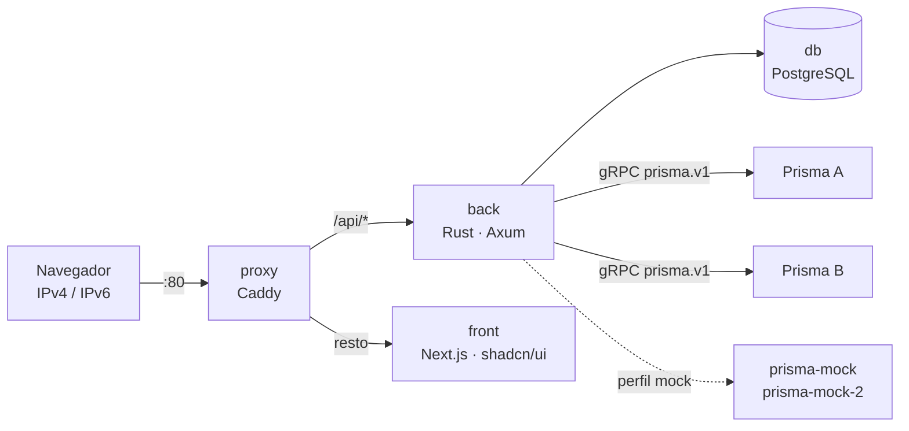

# prisma-web

**TL;DR:** interface web para gerenciar **vários roteadores Prisma** ao mesmo tempo. Ela fala com
cada um pelo contrato gRPC oficial (`prisma.v1`) e altera a configuração pelo modelo do próprio VTY:
candidate, diff, `commit check` e `commit confirmed`. Também mostra painéis e gráficos da telemetria,
registra no log quem mudou o quê e roda inteira em Docker, com IPv4 e IPv6. A conexão com um Prisma
real é por mTLS, com os certificados lidos de um diretório do host montado somente leitura.

As palavras-chave MUST, MUST NOT, SHOULD e MAY seguem a [RFC 2119](https://www.rfc-editor.org/rfc/rfc2119).

| 5W2H | |
|---|---|
| **What** | Painel, configuração, CGNAT, roteamento e console de cada Prisma; homepage em widgets por usuário; contas locais e log de mudanças. |
| **Why** | Mexer num roteador de produção pela web só é aceitável se cada mudança for revisada antes, puder se desfazer sozinha e ficar registrada com autor e diff. |
| **Who** | Administradores (usuários e cadastro de roteadores), operadores (alterações e console) e leitura. |
| **Where** | Um host com Docker, que alcance a porta gRPC de cada Prisma. |
| **When** | Versão em [`VERSION`](VERSION); histórico em [`CHANGELOG.md`](CHANGELOG.md). |
| **How** | Seis containers (abaixo). Detalhes em [`docs/arquitetura.md`](docs/arquitetura.md). |
| **How much** | Medido em 2026-10-01 com 3 Prismas cadastrados: imagens de 655 MB no total (postgres 297, front 237, caddy 63, back 32, mock 27) e cerca de 175 MiB de RAM somando os containers (back 41 MiB). Cada Prisma custa ao back uma conexão gRPC e um stream de telemetria. |



| Container | O que faz para você |
|---|---|
| `proxy` | Única porta exposta (80, IPv4 e IPv6). Manda `/api` para o back e o resto para o front. |
| `front` | As telas. Fala só com o back e nunca com um Prisma direto. |
| `back` | Login, papéis, log de mudanças, cadastro de roteadores e ponte gRPC: consulta, telemetria e configuração. |
| `db` | Usuários (hash Argon2id), sessões, roteadores, homepages e log de mudanças. Fica numa rede interna, sem porta publicada. |
| `prisma-mock`, `prisma-mock-2` | Dois Prismas simulados que implementam o proto inteiro, para desenvolver sem equipamento. |

## Subindo

```bash
cp .env.example .env            # defina POSTGRES_PASSWORD
docker compose up -d --build
docker compose logs back | grep "administrador inicial"   # senha gerada do admin
```

Acesse `http://<ipv4>/` ou `http://[<ipv6>]/`. A troca de senha é exigida no primeiro login.

Com `COMPOSE_PROFILES=mock` (o padrão do `.env.example`), o primeiro mock é cadastrado sozinho. O
segundo é cadastrado em **Roteadores** com o endereço `http://prisma-mock-2:50051`.

## Cadastrando um Prisma real

O Prisma só aceita **mTLS** ([`docs/prisma-api.md`](docs/prisma-api.md), o guia oficial). A API
existe a partir da **0.148.4** e MUST estar habilitada no equipamento (`api enabled yes`).

1. **Coloque os certificados no host**, nunca no repositório nem na imagem. Cada subdiretório de
   `PRISMA_TLS_DIR` (padrão `/etc/prisma-web`) é um **perfil**, com `ca.crt` (a CA que assinou o
   certificado do Prisma) e **um** par `<nome>.crt` e `<nome>.key` do cliente. O CN do certificado
   do cliente é a conta com que o prisma-web aparece no Prisma.

   ```text
   /etc/prisma-web/prisma-api/ca.crt
   /etc/prisma-web/prisma-api/prisma-web.crt
   /etc/prisma-web/prisma-api/prisma-web.key   # modo 0640, grupo PRISMA_TLS_GID
   ```

2. **Garanta que o back consegue ler:** o diretório é montado somente leitura, e o back roda com o
   grupo `PRISMA_TLS_GID` (padrão `1000`), que MUST ser o grupo dono dos arquivos.
3. **Cadastre em Roteadores → Cadastrar Prisma:** endereço `https://<ip>:50051` (IPv6 entre
   colchetes), o perfil (que aparece como `host/<subdiretório>`) e o nome no certificado do servidor
   (`prisma-api` no Prisma). **Testar** mostra a versão e a conta usada. `http://` sem TLS fica só
   para os simulados.

Os simulados: o `prisma-mock` atende sem TLS e o `prisma-mock-2` exige mTLS como o real, com
certificados de desenvolvimento gerados pelo serviço `dev-certs` (perfis `dev/…`).

## Mudando a configuração

Toda alteração, seja pela tela de Interfaces ou pelo editor em **Configuração**, abre um candidate
no Prisma:

1. as linhas são aplicadas como no prompt, e uma recusa do VTY aparece com a linha e o caminho;
2. a revisão mostra o diff e o `commit check`;
3. os portões `remap`, `cutoff` e `diverge` exigem uma confirmação explícita;
4. o commit SHOULD ser `commit confirmed`, que é o padrão de 5 min: se ninguém confirmar a tempo,
   o próprio Prisma desfaz a mudança;
5. o comentário leva `[prisma-web:<usuário>]`, para a trilha do equipamento saber quem foi.

Um candidate pertence a quem o abriu. Só o autor ou um admin pode confirmar um `commit confirmed`.
**Salvar para o boot** (`save`) é um passo separado: sem ele, a mudança vale até o próximo reboot.

## Acesso e auditoria

| Papel | Pode |
|---|---|
| `admin` | Tudo, inclusive usuários, cadastro de roteadores e confirmar commits de outros. |
| `operator` | Alterar a configuração, usar o console e ver o log. |
| `viewer` | Só ver. |

- **Sessões:** cookie `HttpOnly` com `SameSite=Strict`, e o banco guarda só o SHA-256 do token.
- **Força bruta:** 10 falhas em 15 min bloqueiam o IP, ou o /64 inteiro no caso de IPv6.
- **Log de mudanças:** registra logins, usuários, roteadores, cada commit com o seu diff, as
  confirmações, os comandos do console e os eventos do próprio equipamento (`box.*`). Um rollback
  automático de `commit confirmed` sempre entra no log.

## Testes

| Suíte | Comando |
|---|---|
| Back (unidades e integração do mock) | `docker run --rm -v "$PWD/back":/src -w /src rust:1-bookworm cargo test --workspace` |
| Front (lint e build) | `docker run --rm -v "$PWD/front":/w -w /w node:22-alpine sh -c "npm ci && npm run lint && npm run build"` |
| Ponta a ponta, contra a stack no ar | `E2E_USER=admin E2E_PASSWORD=… scripts/e2e.py --base http://[::1]` |
| Prisma real, **só leitura** | `E2E_USER=admin E2E_PASSWORD=… scripts/e2e.py --lab https://<ip>:50051 --lab-profile host/prisma-api` |
| Documentação e versões | `scripts/check-docs.py` |

## Contribuindo

As regras de issues, branches, documentação e releases estão em [`CONTRIBUTING.md`](CONTRIBUTING.md).
