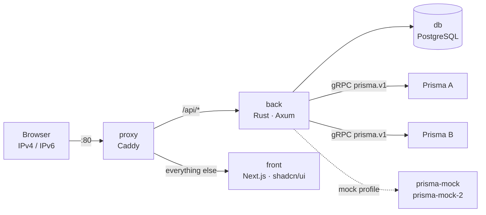

# prisma-web

**TL;DR:** a web interface to manage **several Prisma routers** at once. It talks to each one
through the official gRPC contract (`prisma.v1`) and changes the configuration through the VTY's own
model: candidate, diff, `commit check` and `commit confirmed`. It also shows dashboards and charts
from the telemetry, logs who changed what, and runs entirely in Docker, with IPv4 and IPv6. The
connection to a real Prisma uses mTLS, with the certificates read from a host directory mounted
read-only.

The key words MUST, MUST NOT, SHOULD and MAY follow [RFC 2119](https://www.rfc-editor.org/rfc/rfc2119).

| 5W2H | |
|---|---|
| **What** | Dashboard, configuration, CGNAT, routing, routing policies (with per-term counters and a policy test) and console for each Prisma; a per-user widget homepage; local accounts and a change log. |
| **Why** | Touching a production router through the web is only acceptable if every change is reviewed first, can undo itself, and is recorded with its author and diff. |
| **Who** | Administrators (users and router registration), operators (changes and console) and read-only users. |
| **Where** | A host with Docker that can reach the gRPC port of each Prisma. |
| **When** | Version in [`VERSION`](VERSION); history in [`CHANGELOG.md`](CHANGELOG.md). |
| **How** | Six containers (below). Details in [`docs/architecture.md`](docs/architecture.md). |
| **How much** | Measured on 2026-10-01 with 3 Prismas registered: 655 MB of images in total (postgres 297, front 237, caddy 63, back 32, mock 27) and about 175 MiB of RAM across the containers (back 41 MiB). Each Prisma costs the back one gRPC connection and one telemetry stream. |



| Container | What it does for you |
|---|---|
| `proxy` | The only exposed port (80, IPv4 and IPv6). Sends `/api` to the back and everything else to the front. |
| `front` | The screens. Talks only to the back, never directly to a Prisma. |
| `back` | Login, roles, change log, router registration and the gRPC bridge: queries, telemetry and configuration. |
| `db` | Users (Argon2id hash), sessions, routers, homepages and the change log. Lives on an internal network, with no published port. |
| `prisma-mock`, `prisma-mock-2` | Two simulated Prismas that implement the whole proto, for development without hardware. |

## Starting up

```bash
cp .env.example .env            # set POSTGRES_PASSWORD
docker compose up -d --build
docker compose logs back | grep -i "initial admin"   # generated admin password
```

Open `http://<ipv4>/` or `http://[<ipv6>]/`. A password change is required at the first login.

With `COMPOSE_PROFILES=mock` (the default in `.env.example`), the first mock is registered
automatically. The second one is registered under **Routers** with the address
`http://prisma-mock-2:50051`.

## Registering a real Prisma

The Prisma only accepts **mTLS** ([`docs/prisma-api.md`](docs/prisma-api.md), the official guide).
The API exists from **0.148.4** onwards and MUST be enabled on the device (`api enabled yes`).

1. **Put the certificates on the host**, never in the repository or the image. Each subdirectory of
   `PRISMA_TLS_DIR` (default `/etc/prisma-web`) is a **profile**, with `ca.crt` (the CA that signed
   the Prisma's certificate) and **one** client `<name>.crt` and `<name>.key` pair. The CN of the
   client certificate is the account under which prisma-web appears on the Prisma.

   ```text
   /etc/prisma-web/prisma-api/ca.crt
   /etc/prisma-web/prisma-api/prisma-web.crt
   /etc/prisma-web/prisma-api/prisma-web.key   # mode 0640, group PRISMA_TLS_GID
   ```

2. **Make sure the back can read them:** the directory is mounted read-only, and the back runs with
   the group `PRISMA_TLS_GID` (default `1000`), which MUST be the group that owns the files.
3. **Register it under Routers → Add router:** address `https://<ip>:50051` (IPv6 in square
   brackets), the profile (shown as `host/<subdirectory>`) and the name in the server certificate
   (`prisma-api` on the Prisma). **Test** shows the version and the account used. `http://` without
   TLS is only for the simulated ones.

The simulated ones: `prisma-mock` serves without TLS and `prisma-mock-2` requires mTLS like the real
one, with development certificates generated by the `dev-certs` service (`dev/…` profiles).

## Changing the configuration

Every change, whether from the Interfaces screen or from the editor under **Configuration**, opens a
candidate on the Prisma:

1. the lines are applied as at the prompt, and a VTY refusal is shown with the line and the path;
2. the review shows the diff and the `commit check`;
3. the `remap`, `cutoff` and `diverge` gates require an explicit confirmation;
4. the commit SHOULD be `commit confirmed`, which is the default of 5 min: if nobody confirms in
   time, the Prisma itself undoes the change;
5. the comment carries `[prisma-web:<user>]`, so the device's audit trail knows who it was.

A candidate belongs to whoever opened it. Only the author or an admin can confirm a
`commit confirmed`. **Save for boot** (`save`) is a separate step: without it, the change lasts
until the next reboot.

## Access and auditing

| Role | Can |
|---|---|
| `admin` | Everything, including users, router registration and confirming other people's commits. |
| `operator` | Change the configuration, use the console and see the log. |
| `viewer` | Only view. |

- **Sessions:** an `HttpOnly` cookie with `SameSite=Strict`, and the database stores only the
  SHA-256 of the token.
- **Brute force:** 10 failures in 15 min block the IP, or the whole /64 in the case of IPv6.
- **Change log:** records logins, users, routers, each commit with its diff, confirmations, console
  commands and the device's own events (`box.*`). An automatic rollback of a `commit confirmed`
  always goes into the log.

## Tests

| Suite | Command |
|---|---|
| Back (unit and mock integration) | `docker run --rm -v "$PWD/back":/src -w /src rust:1-bookworm cargo test --workspace` |
| Front (lint and build) | `docker run --rm -v "$PWD/front":/w -w /w node:22-alpine sh -c "npm ci && npm run lint && npm run build"` |
| End to end, against the running stack | `E2E_USER=admin E2E_PASSWORD=… scripts/e2e.py --base http://[::1]` |
| Real Prisma, **read-only** | `E2E_USER=admin E2E_PASSWORD=… scripts/e2e.py --lab https://<ip>:50051 --lab-profile host/prisma-api` |
| Documentation and versions | `scripts/check-docs.py` |

## Contributing

The rules for issues, branches, documentation and releases are in [`CONTRIBUTING.md`](CONTRIBUTING.md).
