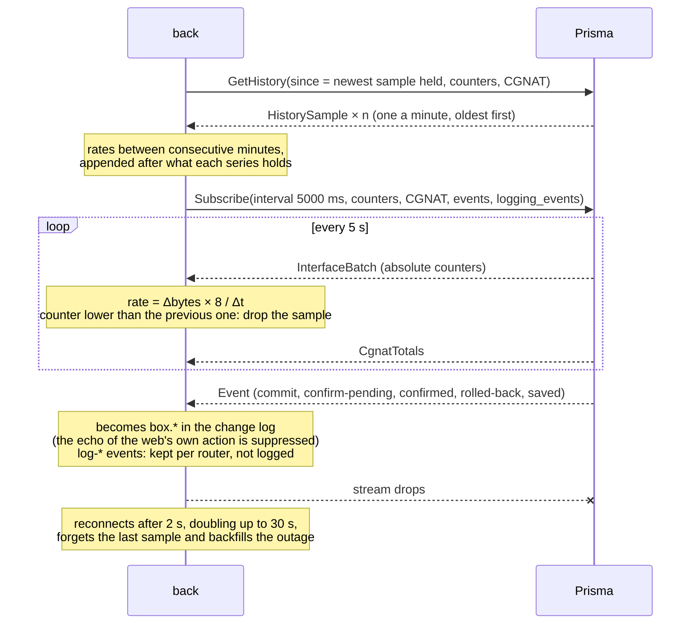
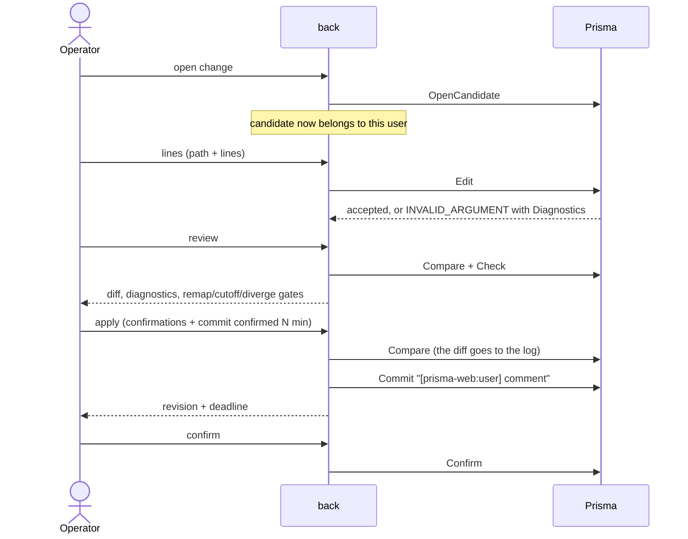

# prisma-web architecture

**TL;DR:** the Rust back is the only piece that talks to the Prismas. For each registered router it
keeps a gRPC channel, a telemetry stream and the cached status. To the front it serves a REST API.
Changes follow the VTY model (candidate, diff, check, commit confirmed), and each candidate belongs
to the web user who opened it. The chart history is built in the back, in memory, from the
telemetry counters, and filled from the box's own history on every connection.

The key words MUST, MUST NOT, SHOULD and MAY follow [RFC 2119](https://www.rfc-editor.org/rfc/rfc2119).

| 5W2H | |
|---|---|
| **What** | How the back talks to the Prismas and why each piece is the way it is. |
| **Why** | Whoever changes the integration needs to know what was decided and what was discarded. |
| **Who** | Whoever develops prisma-web or the management side of the Prisma. |
| **Where** | `back/crates/server` (bridge), `back/crates/prisma-proto` (generated code) and `back/crates/prisma-mock`. |
| **When** | Since version 0.3.0 (issue #3). |
| **How** | Sections below. |
| **How much** | Per router: one HTTP/2 channel, one telemetry stream every 5 s and 24 h of history in memory. |

## Contract

The contract is `back/proto/prisma/v1/prisma.proto`, a copy of the Prisma's proto, and the official
API guide is `docs/prisma-api.md`. Both are copied without changes and are already in English, so
they need no language exception in CONTRIBUTING. The copy of 2026-10-01 is the Prisma's newest
version, which only changes a comment relative to the previous one: the generated code is identical,
compared byte by byte (issue #9). The `prisma-proto` crate generates the types, clients and servers
with `tonic` and `prost`. The `.proto` is compiled by **protox** (pure Rust), so the build does not
depend on `protoc` in the image.

| Decision | Rejected | Why |
|---|---|---|
| Copy the proto into `back/proto` | Submodule of the Prisma repository | The build stays reproducible without access to another repository. The proto's compatibility rules (add only) make the lag safe. |
| `serde::Serialize` generated on the proto types | Hand-written DTOs | The JSON the front receives is the contract itself, with no third description to maintain. |
| REST API between front and back | gRPC-web directly from the browser | Authentication, roles, candidate ownership and auditing MUST stay in one place, and the browser MUST NOT reach the Prismas. |

### Keeping up with the contract

`prisma.v1` only grows, and prisma-web is built so that growth never breaks its build: the server
traits get a default for every rpc, answering `UNIMPLEMENTED` until the mock implements it (#22),
and every proto struct literal in the back end and the mock ends with `..Default::default()`, so a
field added to an existing message is simply left at its default (#23). A new rpc or field reaches
the UI only when a change uses it.

## mTLS with the Prismas

The Prisma only accepts mTLS, and the account used on the device is the CN of the client
certificate. The certificates live **in files on the host**, mounted read-only in the back at
`/run/prisma-tls/host`. Each router points to a **profile**: a subdirectory with `ca.crt` and a
`<name>.crt`/`<name>.key` pair. It also stores the name the server presents (`domain_name`,
`prisma-api` on the Prisma).

| Decision | Rejected | Why |
|---|---|---|
| Profile in files, mounted read-only | Uploading the certificate and key through the screen, with the key encrypted in the database | The key never goes through the browser, the API or the database backups. The Prisma team explicitly asked to keep it out of the repository and the image. |
| One profile per router | A single global identity through environment variables | Serves several Prismas, with different CAs and accounts. |
| `https://` MUST have a profile, and `http://` MUST NOT | Accepting TLS without a client certificate | The Prisma refuses a client without a certificate, and a middle ground would only postpone the error. The rule is also in the database (`routers_tls_consistent`). |
| `http://` only with `PRISMA_ALLOW_PLAINTEXT=true` | Accepting `http://` everywhere | Plaintext exists for the simulated Prismas; a real one only speaks mTLS, and a router registered as `http://` failed with handshake errors instead of a clear refusal (#35). With the flag off, an existing `http://` router is listed offline with the reason and never dialled; a router that cannot be dialled no longer fails the whole fleet. |

The profile id comes from the client and is validated against path traversal (`tls::tests`). The
profile listing shows the account (CN), the CA and the validity, but never the contents of the
files.

`prisma-mock-2` serves mTLS like the real Prisma. The `dev-certs` service generates a development
CA and five profiles: `dev/mock` (valid), `dev/other-ca` (the client MUST refuse the server),
`dev/intruder` (the server MUST refuse the client), `dev/readonly` (CN `noc`, which the mock maps
to a read-only login) and `dev/cgnat` (CN `cgnat-ops`, a cgnat-operator, whose edits outside
`nat > cgnat` the mock refuses like the box, #41). `scripts/e2e.py` checks all five. The mock takes the account from the client
certificate's CN like the box, and its roles from `MOCK_ACCOUNTS`.

## Builds

The Rust images cache their compiled artifacts per compose project (`CACHE_ID`, set from
`COMPOSE_PROJECT_NAME`), and the mock image is named after the project. Two checkouts building at
once (a test stack and the running one) otherwise shared one cargo target directory, and cargo's
file-time fingerprints then reused one branch's build-script output for another's sources (#44).

## Fleet status

The monitor queries `GetVersion`, `GetSystem` and `GetSessionsSummary` of every router in parallel,
every 5 s, with a 4 s limit, and the interface reads that cache. Alongside them it asks the
standard health check (`grpc.health.v1`) for `prisma.v1.OperationalService`: a box that answers
`NOT_SERVING` is shown as *not serving* with the reason (its dataplane's statistics do not
answer), not as *offline*. A box without the health service reports no health and is judged by
the reads alone (#29). It also asks `prisma.v1.LogExport` (Prisma 0.149.15): `NOT_SERVING` there
means a configured CGNAT log stream is stalled and is shown as *log export stalled*, separately
from the router's own state (#34). The mock's `Show "mock stats-segment down|up"` simulates it for e2e. The first query of a newly
registered router happens in the request itself.

Measurement from version 0.2.0, still valid: with one router down, the status dropped from about
3 s (the timeout wait) to 4 to 7 ms.

## Telemetry

- **History in memory (24 h), backfilled from the box:** storing it in PostgreSQL was rejected,
  because it would be 17,280 samples per interface per day just to feed charts. Since Prisma
  0.149.2 the box keeps its own 24 h at one sample a minute (`GetHistory`), so before each
  `Subscribe` the back reads the samples newer than the newest it holds and turns them into rates
  with the same reset rule. A restart of the back costs the 5 s resolution of the past, not the
  past itself (#26). Charts are downsampled by time, so minute and 5 s samples share one series.
  Covered by `telemetry::tests::history_backfills_rates_skips_resets_and_never_duplicates`.
- **Counter reset:** a reboot or a `clear counters` must not turn into a traffic spike. The sample
  is dropped and becomes the new baseline. This is covered by the test
  `telemetry::tests::counter_reset_produces_no_sample`.
- **Echo:** a `commit` event whose revision prisma-web committed itself is its echo and does not
  create a second log entry; any other revision is a change made on the device, even right after a
  web action (#30). Other events (confirmation, save) and a commit event without a revision count
  as the echo when they arrive up to 8 s after a web action. Covered by
  `telemetry::tests::own_commit_is_matched_by_revision_not_by_time`.
  `rolled-back` is the exception: it always goes into the log, because nobody asked for it.

## Uptime breakdown

From Prisma 0.148.7, `SystemInfo` says since when each part of the box runs: the kernel boot, the
dataplane (VPP, by its own clock), the routing daemons, the management container, why the box last
booted (verbatim, never guessed) and when the running release was installed. `dataplane_restarted`
is true when the dataplane started more than five minutes after the box, which means it restarted
by itself and dropped every session it carried. prisma-web shows the breakdown in the router's
Uptime card and warns in the fleet and in the router dashboard when the dataplane restarted (#20).
A field the box could not read is unset and MUST be shown as unknown, never as zero or as 1970;
`crate::ser::timestamp` serializes an unset timestamp as `null`.

## Routing policies

From Prisma 0.148.12 the back end passes three read-only rpcs through (#21): `ListPolicies`
(`GET /api/routers/{id}/policies`), `GetPolicyCounters` (`GET …/policies/counters?policy=`) and
`TestPolicy` (`POST …/policies/test`, operators only, since it makes the box work even though it
changes nothing). The Policies tab shows each policy with its terms, default action, where it is
applied and its VTY text; the counters per attach point, where `counted = false` is shown as
"no counter" (the daemon reported no such map, which is not zero) and `compiled = false` as "not
compiled here"; and a test form with the verdict, the deciding term, every step and the route
before and after the sets. A `then reject` term with `from policy X` is not special-cased. Before
Prisma 0.148.13 the box rejected more than X accepts (Prisma #542). From 0.148.13 it rejects only
the routes X accepts, and the routes X rejects continue to the next term, as in Junos. A commit is
still refused when X itself holds a `from policy` term that is not `accept` (the VTY says why), and
a policy literally named `X-SUB` or `X-NOT` may collide (Prisma #543, open).

Since #89 the tab is a menu - **Policy** (all of the above), **Prefix-list** and **BGP community** -
each a page under `routers/[id]/policies/`, in the sidebar as a sub-menu and in a row above the page
(`components/sub-nav.tsx`, shared with Routing). `policies/layout.tsx` holds
`components/policies/policies-context.tsx`: GetConfig's `policy` and `frr_lists` areas (Prisma
0.149.24) read once, the staged changes and their review. policy-options' `prefix-list`,
`community`, `large-community` and `extended-community` are shown with their members and the
policies that name them - read from ListPolicies' text (`from <kind> <name>`, `set <kind> add|set|delete
<name>`), so it holds on any box - and an administrator of the box adds and removes members and
lists. They are written as lines, as the contract writes policy-options: a prefix-list's networks in
its own mode (`policy-options > prefix-list <name>`), a community as one `members` line, rewritten
whole (`no community X`, then the line), since the contract does not say whether a second line adds
or replaces. A list a policy names asks before it is removed. FRR's own `ip`/`ipv6 prefix-list` and
`bgp community-list`/`large-community-list` are shown read only; a box before 0.149.24 answers 501
for the areas and the pages say it does not report the lists. `front/src/lib/policy-lists.ts` holds
the checks of a member by kind and the lines.

## Routing table

From Prisma 0.149.2 the back end passes `RouteService` through (#27): `ListRoutes`
(`GET /api/routers/{id}/routes?vrf=&family=&prefix=&protocol=&selected=&page_size=&page_token=`)
and `GetRouteSummary` (`GET …/routes/summary?vrf=`), both open to every role, like the other
reads. A full table holds about a million routes, so the back end MUST NOT read it whole: each
request is one `ListRoutes` call, one page of the box's snapshot. `page_size` is capped at 5000,
Prisma's own ceiling, and it is per call, so a token request sends it again; the filters belong
to the snapshot and a token ignores them. The call gets 65 s instead of the usual 10, because a
page waits up to 60 s for the box's snapshot to reach it. Empty query fields mean "any", so the
query is parsed by hand into a JSON 422 rather than refused by Axum as plain text.

The Routing tab shows the summary (RIB and FIB per VRF, family and protocol; a row filters the
table to it) and the table, with a prefix search, VRF, family, protocol and selected-only
filters, and server-side paging. The front keeps a stack of the tokens it reached, so Back
returns to a page already read without asking the box again; the first page (no token) is a new
snapshot and is fetched only when the filters change or on New snapshot, never on focus. The
total is shown only when `total_known`, and the snapshot time always. A token the box no longer
holds (idle for 10 minutes, or one of more than four snapshots) answers 409 and the tab offers a
new snapshot. A box without `RouteService` answers `UNIMPLEMENTED`, which the back end turns into
501 `router_unimplemented`, and the tab falls back to the text of `show ip route` and
`show ipv6 route` through `Show`, as before (that view needs an operator, like the console).

The mock serves a fixed table of 11,710 routes (two VRFs, both families; bgp, connected, local,
static, ospf and ospf6, with floating statics that BGP beats, so selected-only and RIB versus FIB
differ), three pages at 5000. Its refusals follow what Prisma 0.149.4 answered on the lab box: an
unknown VRF is `NOT_FOUND`, an unknown protocol word `INVALID_ARGUMENT`, and a malformed or
unknown token `FAILED_PRECONDITION`. One difference is deliberate: the mock's first page reports
`total_known = false` whenever more pages follow, so the "total not known yet" path is always
exercised, while the lab box, with 9 routes, knew its total on the first page.

## Configuration

- **Pending commit confirmed:** read from the box with `GetPendingConfirm` (Prisma 0.149.18), so
  the banner survives a restart of the back; the web user is the `[prisma-web:<user>]` of the
  commit's comment, and an overdue window (the box failed to revert) is shown as such. An older box
  keeps the banner in the back's memory, from the commit's own reply and the `confirm-pending` /
  `confirmed` events (#37).
- **One account for everyone:** without a certificate, every web user is the same account on the
  Prisma. That is why the back MUST control candidate ownership (`routes/config.rs`). The commit
  MUST carry the user in the comment, and `Confirm`, which applies to the whole account, is only
  accepted from the author or an admin.
- **Orphaned and idle candidates:** since Prisma 0.149.18 the box says when it closes a candidate
  (`expires_at` and `idle_seconds` from `OpenCandidate`, a new `expires_at` from each `Edit`), and
  why a call on a gone one fails (`REASON_CANDIDATE_EXPIRED` or `REASON_CANDIDATE_UNKNOWN`). The
  back follows that expiry (5 s early) and answers `candidate_expired` (410) only for an expiry; an
  unknown candidate is a plain 404. The editor shows when the change closes if left idle. On an
  older box the 25-minute rule applies (from the last call, under the box's 30), and any `NOT_FOUND`
  on a candidate is taken as an expiry (#11, #37). It is closed on the next `OpenCandidate`. The
  configuration screen closes its own on exit, and after an expiry reopens one and applies the
  same lines again (#11). `prisma-mock-2` closes candidates after 15 s
  (`MOCK_CANDIDATE_IDLE_SECS`) so e2e sees it happen. A crash of the back still leaves candidates open
  on the Prisma until the Prisma discards them (question 1.4 of `prisma-integration.md`).
- **Refusal reasons and stale base:** since Prisma 0.149.18 every refused configuration call
  carries `Diagnostics.reason` (stale base, gates, confirm pending, grammar, limit…), which reaches
  the front end by name. A commit refused with `REASON_STALE_BASE` answers `candidate_stale` (409)
  without reading anything else. On an older box, whose wording is not part of the contract, the
  back compares the candidate's base revision with the running one on a `FAILED_PRECONDITION`
  commit, as before (#10, #37). The review offers to reopen: a new candidate on the current configuration, the same edits
  applied again in order, and a new review of the new diff; nothing is committed on the way. A line
  the new base refuses is shown like any edit refusal, with its lines back in the form (#10).
- **Structured configuration (#39):** the **Settings** tab reaches every statement of the VTY's
  configuration without typing it. The grammar comes from the vendored coverage map, which Prisma
  generates from the VTY's own grammar (#558): `scripts/config-grammar.py` extracts it to
  `back/crates/server/src/config_grammar.json` (`check-docs.py` fails when it is stale), and
  `config_model.rs` parses each statement's syntax (keywords, typed values with their ranges,
  optional parts, choices). The running configuration is read as a tree and every line matched to
  its statement, which also gives the values to prefill a form. Forms are generated from the syntax;
  changes accumulate and are applied as lines to one candidate, then go through the usual review.
  A line no statement matches (FRR's own, the backplane VRF) is shown read-only. The box account's
  role decides what is editable (a cgnat-operator only the CGNAT modes). Since Prisma 0.149.20 the
  grammar comes from the box's `GetSchema` (kept ten minutes per router), converted to the same
  model (`config_model::from_schema`); the coverage map remains the source for an older box. The
  box's own lines are marked from `TypedConfig.box_owned`, with the box's reason, and a setting can
  be checked by the VTY itself (`ValidateLines`, nothing staged) before it joins the changes (#44).
  From Prisma 0.149.24 a statement's `words` are literal and each argument carries its `position`
  among them; `from_schema` places each form's arguments there and keeps the words every form
  starts with in front (#47).
  The syntax parser lives in `prisma_proto::vty`, shared with the mock, whose `GetSchema` is built
  from the same grammar. A real box's schema puts placeholders in a statement's words (`<prefix>`,
  `neighbor <address>`) and once splits a range choice (`1-4294967295>`), and its running
  configuration writes keyword parts in its own order (`port … enterprise …`); prisma-web parses the
  words with the syntax parser, takes a choice that is a value as a value, and accepts a statement's
  keyword parts in any order. On 192.0.2.198 every operator line matches its statement (#45).
- **Interface forms (#40):** the **Interfaces** tab edits a port (`interface <name>`) or a bundle
  (`interface bond<n>`) in one form: description, MTU, admin state, IPv4 and IPv6 addresses (a
  list per family, dual stack), VRF, CGNAT side, uRPF, `ipv6 nd suppress-ra`, VLAN, Linux name and
  MAC address, and for a bundle its members, LACP mode and rate and load balancing. A new bundle is
  created by its first lines. The rest of the mode (OSPF, IS-IS, VRRP) is listed and reached on the
  Settings page (`settings?at=interface <name>`). The form reads the running configuration tree and
  MUST refuse an invalid address before it reaches the box: not an address of the family, a /0, an
  IPv4 network or broadcast address, a multicast address, an address already on the interface, or
  one that overlaps a prefix of another interface in the same VRF. Saving stages the lines (removals
  first, so an address can be replaced) with `use-config-changes.ts`, the staging the Settings page
  uses too; they go to one candidate and the usual review. `front/src/lib/interface-config.ts` is
  the only place that knows the interface lines, and holds the typed implementation too (#46). There is no statement to delete a bundle in the grammar, so the
  form does not offer it.
- **CGNAT forms (#41):** the **CGNAT** tab edits `nat > cgnat` without the generic editor: the
  global settings (timeouts, block hold-down, inside and outside interfaces, subscriber identity,
  session table and memory), the pools (create, edit, remove; prefixes, block size, mode, policy,
  limits, filtering and ALGs, the rest of a pool through a link to Settings) and the log collectors
  (syslog, IPFIX over TCP and UDP, each sent to a collector or disabled). `front/src/lib/cgnat-config.ts`
  is the only place that reads those lines from the tree and writes them, and holds the typed
  GetConfig/SetConfig implementation beside them (#46). Changes are staged with
  `use-config-changes.ts`, keyed by form so editing again replaces them, each with an optional
  warning shown in the staged list, and go through ChangeReview, which keeps the gates. A form MUST say before the review what the gates
  will ask: a new block size, a prefix change or a removed pool remaps subscribers, and disabling
  a syslog that was never enabled is refused by the back before 0.149.8 (#31), whose reason the
  review shows. A statement the VTY has no `no` form for (the global timeouts, a pool's block
  size, mode and policy, a collector) can be changed, not cleared. A cgnat-operator gets these
  forms and, outside `nat > cgnat`, nothing (Settings shows the rest read-only). The Log export
  card reads GetLogging, which reports the collectors the configuration sets, so it follows a
  commit; the mock derives its streams from its running configuration the same way.
- **Routing forms (#42, #43):** the **Routing** tab has dedicated forms for BGP (global settings,
  neighbors with their live `ListBgpNeighbors` state beside their configuration, and per IPv4/IPv6
  unicast family: activation and policies per neighbor, networks, aggregates, redistribution), OSPF
  and OSPF6 (router ID, areas, OSPFv2 networks, redistribution, and per interface the area, cost
  and passive switch) and static routes (IPv4 and IPv6, next hop or interface, distance, tag).
  `front/src/lib/routing-config.ts` is the only place that reads these statements (from
  `/config/tree`) and builds their lines, with the syntax of `config_grammar.json`, and the typed
  reads and edits of Prisma 0.149.22 beside them (#46). Changes are staged with
  `front/src/hooks/use-config-changes.ts`, shared with the other configuration tabs, and go through the same
  candidate and review. Since #88 the tab is a menu - Routing table, Static, BGP, OSPF, IS-IS, BFD,
  VRRP and Logging, each a page under `routers/[id]/routing/`, in the sidebar as a sub-menu and in
  a row above the page; a sub-menu opens while one of its pages is shown, and its chevron opens or
  closes it without leaving the page (#90) - and `routing/layout.tsx` holds what they share
  (`components/routing/routing-context.tsx`: the configuration read once, the staged changes and
  the review), so a change staged on one page is still staged on another and they are applied
  together. Bundles are on the Interfaces page. A changed `remote-as` is sent as the new line alone, because FRR's
  `no neighbor … remote-as` removes the whole neighbor; `no neighbor <address>` is how a neighbor
  is removed as a line before Prisma 0.149.20 and from 0.149.23, and statement by statement in
  between (#46). OSPF6 has no `network` statement: an interface joins an area with
  `ipv6 ospf6 area`. An area is declared only with its type (`area 0.0.0.1 stub`), and a
  neighbor's route map or prefix list in a family with its direction (`NAME in`), as FRR takes
  them (#47). The grammar types a static route's next hop as an address; the form also takes
  an interface name, as the issue asks, and the box has the last word in the review. The forms are
  offered to operators and above whose box account can change the routing modes (administrator).
- **Clears (#48):** `OperationalService.Clear` (Prisma 0.149.25) behind `POST
  /api/routers/{id}/clear` (operator and above, audited as `router.clear`), and
  `front/src/components/clear-action.tsx`, a button with a confirmation that says what the clear
  disrupts, placed where the object is shown (interfaces, BGP sessions, OSPF, IS-IS, a CGNAT
  subscriber). The monitor probes `prisma.v1.SystemService`'s health to know whether a box has it.
- **Live CGNAT log (#49):** the back end's only streaming route, `routes/log_watch.rs`, relays
  `WatchLogging` as Server-Sent Events (axum's `Sse`, a keep-alive every 15 s); Caddy passes
  `text/event-stream` through as it comes. `front/src/components/cgnat/live-log.tsx` reads it with
  `fetch` (not `EventSource`, so a refusal's JSON and its status reach the page) and an
  `AbortController` that ends the stream when the panel stops or the page closes.
- **System actions (#50):** `routes/system.rs` (administrators; the router's name typed in the
  body as `confirm`) and the registry's maintenance window, overlaid on the fleet status when it
  is read (`Registry::maintenance_begin`, `maintenance_until`, `maintenance_end`; it holds until
  `until`, or with no `until` until the box answers again). While it holds the monitor skips the
  box (`Maintenance::quiet`: nothing before `until`, otherwise a probe every 15 s growing to
  60 s) and stops its telemetry stream; the monitor ends it as soon as its last status shows it
  no longer holds (#52). The upgrade is the second
  Server-Sent Events route; `front/src/lib/sse.ts` reads both streams.
- **Forms on the typed configuration (#46):** on a box that answers `GetConfig` for their area
  (Prisma 0.149.20 for interfaces, pools and the log collectors; 0.149.22 for the routing areas),
  the Interfaces, CGNAT and Routing forms read typed and write with `SetConfig` / `DeleteConfig`;
  a box that answers 501 keeps the line implementation of #40-#43. Each data layer
  (`front/src/lib/interface-config.ts`, `cgnat-config.ts`, `routing-config.ts`, with the shapes in
  `typed-config.ts`) holds both implementations behind the same form shapes, and the page picks
  one with `useTypedConfig`, which returns the line form only on a 501, so a typed box that failed
  to answer is never handed lines it would take differently. A typed change is staged in the same
  `use-config-changes.ts` list as a line change, carrying its `SetConfig` / `DeleteConfig` calls;
  they are made against the one candidate when the review opens (lines first, so a new bundle's
  `member` creates it), and the lines the box answers are shown in ChangeReview above the diff,
  which, with the check and the gates, is unchanged. The back end serves
  `GET /api/routers/{id}/config/typed?areas=…[&candidate=…]` (GetConfig; an area the box does not
  type, or a box without the rpc, answers 501 `router_unimplemented`),
  `POST /api/routers/{id}/config/typed/{cid}/set` (one object, `interface`, `pool`, `logging`,
  `static_route` or `bgp_neighbor`, and `fields`) and `POST /api/routers/{id}/config/typed/{cid}/delete`
  (DeleteConfig's `area`, `name`, `transport`, `prefix`, `next_hop`, `asn`, `vrf`), with Edit's
  checks: the candidate's owner, an operator, and a box account that can change something; like an
  Edit, neither is in the change log, whose commit entry keeps the diff. The back end refuses a
  `set` without fields (422), because an empty mask sets every field and clears what a partial
  object leaves out, and masks any `password <secret>` in a reply. What the box does not type yet
  stays lines: a bundle's members, LACP and load balancing, the CGNAT global settings, BGP's global
  settings, networks, aggregates and redistribution, and OSPF. Each routing block's `other`
  statements are listed read only, a BGP password is write only (sent when typed, never read), and a
  VRF's static route is read only. The mock types every area off its configuration and writes the
  lines an operator would type through the same `Config::edit` as Edit; `prisma-mock-lines`
  (`MOCK_NO_TYPED=1`) answers `UNIMPLEMENTED` for the three rpcs, and the browser tests run the
  forms' line specs against it and `typed-forms.spec.ts` against `prisma-mock`.

| Decision | Rejected | Why |
|---|---|---|
| Both implementations in each data layer, chosen per area by whether GetConfig answers | Typed only, or a version check | Boxes before 0.149.20 (the lab box is on 0.149.14) and 0.149.20/21 boxes without the routing areas stay in the fleet; the answer is the box's own, not a version table. |
| Typed calls made when the review opens, the box's lines shown there | Calling SetConfig at "Add to the changes" | One candidate per review, as for lines: nothing reaches the box before the review, and a reopened change (#10) applies the same calls again. |
| A third mock with `MOCK_NO_TYPED=1` | A per-test switch on one mock | The mock has no control plane, and a box either has the calls or not: two registered routers keep both paths under test in the same run. |

## Errors

The back converts the gRPC status into HTTP and passes the `Diagnostics` from
`prisma-diagnostics-bin` on to the front, which shows the message, the path and the line the VTY
cited:

| gRPC | HTTP | Code in the JSON |
|---|---|---|
| `INVALID_ARGUMENT` | 422 | `router_rejected` |
| `FAILED_PRECONDITION` | 409 | `router_refused` |
| `NOT_FOUND` | 404 | `router_not_found` |
| `PERMISSION_DENIED` | 403 | `router_forbidden` |
| `DEADLINE_EXCEEDED` | 504 | `router_timeout` |
| `UNIMPLEMENTED` | 501 | `router_unimplemented` (a box older than the rpc; the front falls back) |
| others | 502 | `router_unavailable` |

## Limits

- Replacing or adding certificates requires access to the host, not to the screen (decision of #4).
- 0.148.4 lists the linux_cp `tap*` interfaces in `ListInterfaces`, and the back hides them
  (`routes/ops.rs`). From 0.148.5 onwards, the Prisma itself omits them (verified in the lab), and
  the filter only has an effect while there are devices on 0.148.4.
- **Console and status (issue #14):** on 0.148.4 and 0.148.5, `Show` shares the account's
  operational process with the reads, which serves one call at a time. A long `ping` made the
  monitor exceed the 4 s, and the router appeared offline (reproduced in the e2e: OFFLINE in 4
  consecutive reads). The back counts the `Show` calls in progress per router and, in that case,
  keeps the latest data with `busy = true` ("busy (console)"). 0.148.6 gives `Show` its own
  process, and the flag is no longer needed. Measured in the lab on 2026-10-01: during a 15 s
  `Show`, 20 `GetVersion` calls took from 0.185 to 0.371 s, against 0.187 to 0.409 s without a
  `Show`. The mock reproduces the 0.148.5 lock. Using a separate account for the console (a second
  certificate and a second account on each device) was rejected, and so was serializing everything
  in the back (it would slow the screens down needlessly on 0.148.6).
- **Per-router access (#6):** a user's web role applies to every router unless `router_access`
  overrides it for one router, up or down; `none` hides that router. The user extractor resolves
  the role whenever the path names a router (`/routers/<id>/…`), so every per-router check uses
  the role on that router, and a hidden router answers 404 as if it did not exist. The router list,
  the fleet status and the change log leave hidden routers out. A global administrator always has
  every router and cannot be limited, and router registration (edit, remove) stays with global
  administrators whatever the grants. Granting and revoking go to the change log
  (`user.access.grant`, `user.access.revoke`).
- Each router also has the box's own role for prisma-web's
  account (`WhoAmI`, refreshed every minute by the fleet monitor). A read-only login disables the
  change actions on that router and the back refuses its changes with `router_read_only` before
  calling the box. A box older than 0.149.2 answers `UNIMPLEMENTED`: the role is unknown and
  nothing is disabled (#28).
- The front has browser tests (`scripts/ui-tests.sh`, #5) for the screen rules the API cannot
  see - at desktop width, and at a phone's (`mobile.spec.ts`, 390 px, #80: no page scrolls
  sideways, every tab and the tables' key columns in sight) - and unit tests of its libraries (`npm test`: `node:test` with the types stripped, no
  dependency; `src/lib/*.test.ts`, since #72); `scripts/e2e.py` covers the behaviour through the API.
