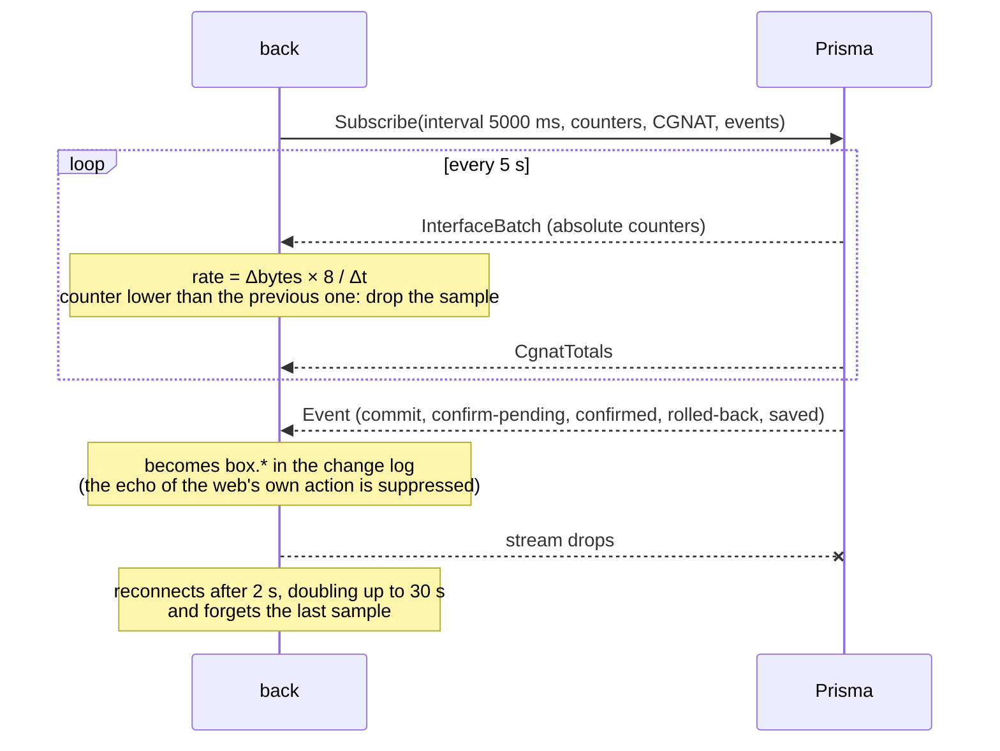
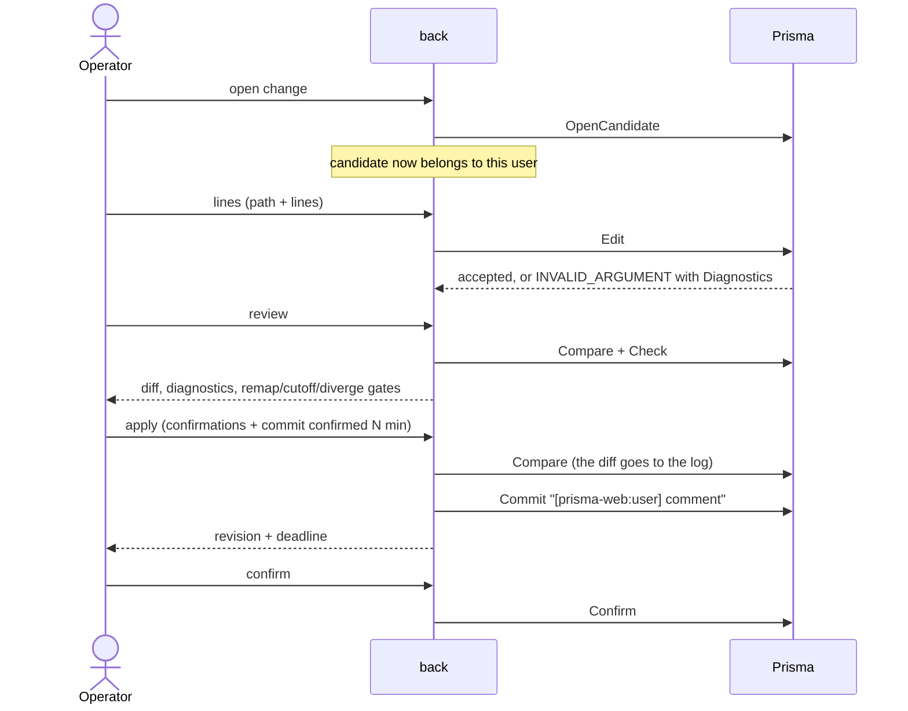

# prisma-web architecture

**TL;DR:** the Rust back is the only piece that talks to the Prismas. For each registered router it
keeps a gRPC channel, a telemetry stream and the cached status. To the front it serves a REST API.
Changes follow the VTY model (candidate, diff, check, commit confirmed), and each candidate belongs
to the web user who opened it. The chart history is built in the back, in memory, from the
telemetry counters.

The key words MUST, MUST NOT, SHOULD and MAY follow [RFC 2119](https://www.rfc-editor.org/rfc/rfc2119).

| 5W2H | |
|---|---|
| **What** | How the back talks to the Prismas and why each piece is the way it is. |
| **Why** | Whoever changes the integration needs to know what was decided and what was discarded. |
| **Who** | Whoever develops prisma-web or the management side of the Prisma. |
| **Where** | `back/crates/server` (bridge), `back/crates/prisma-proto` (generated code) and `back/crates/prisma-mock`. |
| **When** | Since version 0.3.0 (issue #3). |
| **How** | Sections below. |
| **How much** | Per router: one HTTP/2 channel, one telemetry stream every 5 s and 24 h of history in memory. |

## Contract

The contract is `back/proto/prisma/v1/prisma.proto`, a copy of the Prisma's proto, and the official
API guide is `docs/prisma-api.md`. Both are copied without changes and are already in English, so
they need no language exception in CONTRIBUTING. The copy of 2026-10-01 is the Prisma's newest
version, which only changes a comment relative to the previous one: the generated code is identical,
compared byte by byte (issue #9). The `prisma-proto` crate generates the types, clients and servers
with `tonic` and `prost`. The `.proto` is compiled by **protox** (pure Rust), so the build does not
depend on `protoc` in the image.

| Decision | Rejected | Why |
|---|---|---|
| Copy the proto into `back/proto` | Submodule of the Prisma repository | The build stays reproducible without access to another repository. The proto's compatibility rules (add only) make the lag safe. |
| `serde::Serialize` generated on the proto types | Hand-written DTOs | The JSON the front receives is the contract itself, with no third description to maintain. |
| REST API between front and back | gRPC-web directly from the browser | Authentication, roles, candidate ownership and auditing MUST stay in one place, and the browser MUST NOT reach the Prismas. |

### Keeping up with the contract

`prisma.v1` only grows, and prisma-web is built so that growth never breaks its build: the server
traits get a default for every rpc, answering `UNIMPLEMENTED` until the mock implements it (#22),
and every proto struct literal in the back end and the mock ends with `..Default::default()`, so a
field added to an existing message is simply left at its default (#23). A new rpc or field reaches
the UI only when a change uses it.

## mTLS with the Prismas

The Prisma only accepts mTLS, and the account used on the device is the CN of the client
certificate. The certificates live **in files on the host**, mounted read-only in the back at
`/run/prisma-tls/host`. Each router points to a **profile**: a subdirectory with `ca.crt` and a
`<name>.crt`/`<name>.key` pair. It also stores the name the server presents (`domain_name`,
`prisma-api` on the Prisma).

| Decision | Rejected | Why |
|---|---|---|
| Profile in files, mounted read-only | Uploading the certificate and key through the screen, with the key encrypted in the database | The key never goes through the browser, the API or the database backups. The Prisma team explicitly asked to keep it out of the repository and the image. |
| One profile per router | A single global identity through environment variables | Serves several Prismas, with different CAs and accounts. |
| `https://` MUST have a profile, and `http://` MUST NOT | Accepting TLS without a client certificate | The Prisma refuses a client without a certificate, and a middle ground would only postpone the error. The rule is also in the database (`routers_tls_consistent`). |

The profile id comes from the client and is validated against path traversal (`tls::tests`). The
profile listing shows the account (CN), the CA and the validity, but never the contents of the
files.

`prisma-mock-2` serves mTLS like the real Prisma. The `dev-certs` service generates a development
CA and three profiles: `dev/mock` (valid), `dev/other-ca` (the client MUST refuse the server) and
`dev/intruder` (the server MUST refuse the client). `scripts/e2e.py` checks all three.

## Fleet status

The monitor queries `GetVersion`, `GetSystem` and `GetSessionsSummary` of every router in parallel,
every 5 s, with a 4 s limit, and the interface reads that cache. The first query of a newly
registered router happens in the request itself.

Measurement from version 0.2.0, still valid: with one router down, the status dropped from about
3 s (the timeout wait) to 4 to 7 ms.

## Telemetry

- **History in memory (24 h):** storing it in PostgreSQL was rejected, because it would be 17,280
  samples per interface per day just to feed charts. The consequence is that restarting the back
  resets the charts. If the Prisma offers history, this decision changes (item 2.4 of
  `prisma-integration.md`).
- **Counter reset:** a reboot or a `clear counters` must not turn into a traffic spike. The sample
  is dropped and becomes the new baseline. This is covered by the test
  `telemetry::tests::counter_reset_produces_no_sample`.
- **Echo:** an event that arrives up to 8 s after an action taken through the web, such as a commit,
  a confirmation or a save, is treated as its echo and does not create a second log entry.
  `rolled-back` is the exception: it always goes into the log, because nobody asked for it.

## Uptime breakdown

From Prisma 0.148.7, `SystemInfo` says since when each part of the box runs: the kernel boot, the
dataplane (VPP, by its own clock), the routing daemons, the management container, why the box last
booted (verbatim, never guessed) and when the running release was installed. `dataplane_restarted`
is true when the dataplane started more than five minutes after the box, which means it restarted
by itself and dropped every session it carried. prisma-web shows the breakdown in the router's
Uptime card and warns in the fleet and in the router dashboard when the dataplane restarted (#20).
A field the box could not read is unset and MUST be shown as unknown, never as zero or as 1970;
`crate::ser::timestamp` serializes an unset timestamp as `null`.

## Routing policies

From Prisma 0.148.12 the back end passes three read-only rpcs through (#21): `ListPolicies`
(`GET /api/routers/{id}/policies`), `GetPolicyCounters` (`GET …/policies/counters?policy=`) and
`TestPolicy` (`POST …/policies/test`, operators only, since it makes the box work even though it
changes nothing). The Policies tab shows each policy with its terms, default action, where it is
applied and its VTY text; the counters per attach point, where `counted = false` is shown as
"no counter" (the daemon reported no such map, which is not zero) and `compiled = false` as "not
compiled here"; and a test form with the verdict, the deciding term, every step and the route
before and after the sets. A `then reject` term with `from policy X` is not special-cased. Before
Prisma 0.148.13 the box rejected more than X accepts (Prisma #542). From 0.148.13 it rejects only
the routes X accepts, and the routes X rejects continue to the next term, as in Junos. A commit is
still refused when X itself holds a `from policy` term that is not `accept` (the VTY says why), and
a policy literally named `X-SUB` or `X-NOT` may collide (Prisma #543, open).

## Routing table

From Prisma 0.149.2 the back end passes `RouteService` through (#27): `ListRoutes`
(`GET /api/routers/{id}/routes?vrf=&family=&prefix=&protocol=&selected=&page_size=&page_token=`)
and `GetRouteSummary` (`GET …/routes/summary?vrf=`), both open to every role, like the other
reads. A full table holds about a million routes, so the back end MUST NOT read it whole: each
request is one `ListRoutes` call, one page of the box's snapshot. `page_size` is capped at 5000,
Prisma's own ceiling, and it is per call, so a token request sends it again; the filters belong
to the snapshot and a token ignores them. The call gets 65 s instead of the usual 10, because a
page waits up to 60 s for the box's snapshot to reach it. Empty query fields mean "any", so the
query is parsed by hand into a JSON 422 rather than refused by Axum as plain text.

The Routing tab shows the summary (RIB and FIB per VRF, family and protocol; a row filters the
table to it) and the table, with a prefix search, VRF, family, protocol and selected-only
filters, and server-side paging. The front keeps a stack of the tokens it reached, so Back
returns to a page already read without asking the box again; the first page (no token) is a new
snapshot and is fetched only when the filters change or on New snapshot, never on focus. The
total is shown only when `total_known`, and the snapshot time always. A token the box no longer
holds (idle for 10 minutes, or one of more than four snapshots) answers 409 and the tab offers a
new snapshot. A box without `RouteService` answers `UNIMPLEMENTED`, which the back end turns into
501 `router_unimplemented`, and the tab falls back to the text of `show ip route` and
`show ipv6 route` through `Show`, as before (that view needs an operator, like the console).

The mock serves a fixed table of 11,710 routes (two VRFs, both families; bgp, connected, local,
static, ospf and ospf6, with floating statics that BGP beats, so selected-only and RIB versus FIB
differ), three pages at 5000. Its refusals follow what Prisma 0.149.4 answered on the lab box: an
unknown VRF is `NOT_FOUND`, an unknown protocol word `INVALID_ARGUMENT`, and a malformed or
unknown token `FAILED_PRECONDITION`. One difference is deliberate: the mock's first page reports
`total_known = false` whenever more pages follow, so the "total not known yet" path is always
exercised, while the lab box, with 9 routes, knew its total on the first page.

## Configuration

- **One account for everyone:** without a certificate, every web user is the same account on the
  Prisma. That is why the back MUST control candidate ownership (`routes/config.rs`). The commit
  MUST carry the user in the comment, and `Confirm`, which applies to the whole account, is only
  accepted from the author or an admin.
- **Orphaned candidates:** those open for more than 1 h are closed on the next `OpenCandidate`, and
  the configuration screen closes its own on exit. A crash of the back still leaves candidates open
  on the Prisma until the Prisma discards them (question 1.4 of `prisma-integration.md`).
- **Interface grammar:** `front/src/lib/vty.ts` is the only place that knows the `description`,
  `mtu` and `shutdown` lines. They are an assumption until the Prisma confirms them.

## Errors

The back converts the gRPC status into HTTP and passes the `Diagnostics` from
`prisma-diagnostics-bin` on to the front, which shows the message, the path and the line the VTY
cited:

| gRPC | HTTP | Code in the JSON |
|---|---|---|
| `INVALID_ARGUMENT` | 422 | `router_rejected` |
| `FAILED_PRECONDITION` | 409 | `router_refused` |
| `NOT_FOUND` | 404 | `router_not_found` |
| `PERMISSION_DENIED` | 403 | `router_forbidden` |
| `DEADLINE_EXCEEDED` | 504 | `router_timeout` |
| `UNIMPLEMENTED` | 501 | `router_unimplemented` (a box older than the rpc; the front falls back) |
| others | 502 | `router_unavailable` |

## Limits

- Replacing or adding certificates requires access to the host, not to the screen (decision of #4).
- 0.148.4 lists the linux_cp `tap*` interfaces in `ListInterfaces`, and the back hides them
  (`routes/ops.rs`). From 0.148.5 onwards, the Prisma itself omits them (verified in the lab), and
  the filter only has an effect while there are devices on 0.148.4.
- **Console and status (issue #14):** on 0.148.4 and 0.148.5, `Show` shares the account's
  operational process with the reads, which serves one call at a time. A long `ping` made the
  monitor exceed the 4 s, and the router appeared offline (reproduced in the e2e: OFFLINE in 4
  consecutive reads). The back counts the `Show` calls in progress per router and, in that case,
  keeps the latest data with `busy = true` ("busy (console)"). 0.148.6 gives `Show` its own
  process, and the flag is no longer needed. Measured in the lab on 2026-10-01: during a 15 s
  `Show`, 20 `GetVersion` calls took from 0.185 to 0.371 s, against 0.187 to 0.409 s without a
  `Show`. The mock reproduces the 0.148.5 lock. Using a separate account for the console (a second
  certificate and a second account on each device) was rejected, and so was serializing everything
  in the back (it would slow the screens down needlessly on 0.148.6).
- The role applies to all routers.
- The front has no automated tests beyond lint and build. The `scripts/e2e.py` script covers the
  behaviour through the API.
