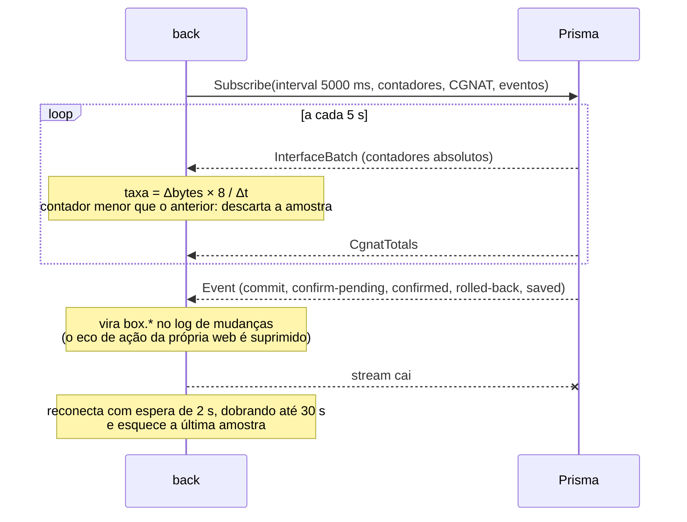
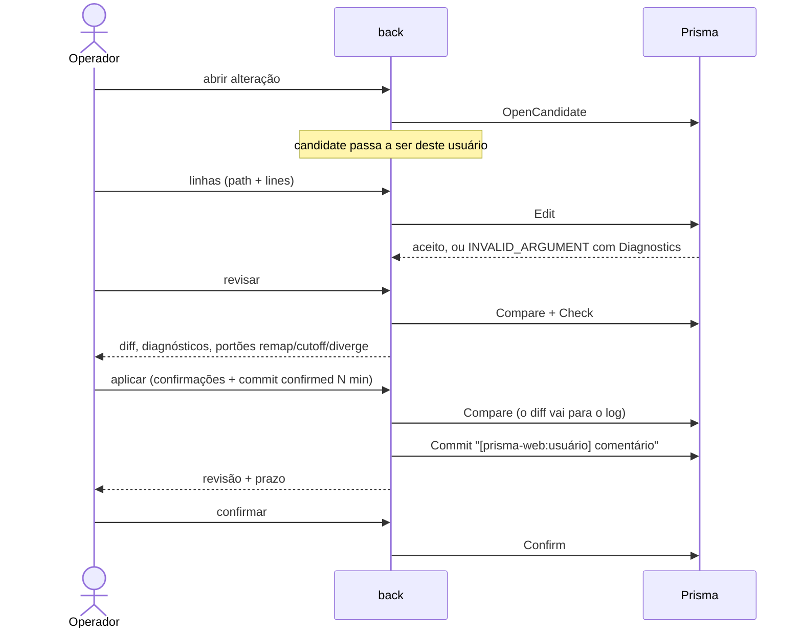

# Arquitetura do prisma-web

**TL;DR:** o back em Rust é a única peça que fala com os Prismas. Para cada roteador cadastrado ele
mantém um canal gRPC, um stream de telemetria e o status em cache. Ao front entrega uma API REST.
As alterações seguem o modelo do VTY (candidate, diff, check, commit confirmed), e cada candidate
pertence ao usuário da web que o abriu. O histórico dos gráficos é montado no back, em memória,
a partir dos contadores da telemetria.

As palavras-chave MUST, MUST NOT, SHOULD e MAY seguem a [RFC 2119](https://www.rfc-editor.org/rfc/rfc2119).

| 5W2H | |
|---|---|
| **What** | Como o back conversa com os Prismas e por que cada peça é assim. |
| **Why** | Quem for mudar a integração precisa saber o que foi decidido e o que foi descartado. |
| **Who** | Quem desenvolve o prisma-web ou o lado de gerenciamento do Prisma. |
| **Where** | `back/crates/server` (ponte), `back/crates/prisma-proto` (código gerado) e `back/crates/prisma-mock`. |
| **When** | Desde a versão 0.3.0 (issue #3). |
| **How** | Seções abaixo. |
| **How much** | Por roteador: um canal HTTP/2, um stream de telemetria a cada 5 s e 24 h de histórico em memória. |

## Contrato

O contrato é `back/proto/prisma/v1/prisma.proto`, uma cópia do proto do Prisma, e o guia oficial
da API é o `docs/prisma-api.md`. Os dois são copiados sem alterações e são exceções de idioma no
CONTRIBUTING. A cópia de 2026-10-01 é a versão mais nova do Prisma, que só muda um comentário em
relação à anterior: o código gerado é idêntico, comparado byte a byte (issue #9). O crate
`prisma-proto` gera os tipos, os clientes e os servidores com `tonic` e `prost`. O `.proto` é
compilado pelo **protox** (Rust puro), para que o build não dependa de `protoc` na imagem.

| Decisão | Rejeitado | Por quê |
|---|---|---|
| Copiar o proto para `back/proto` | Submódulo do repositório do Prisma | O build fica reprodutível sem acesso a outro repositório. As regras de compatibilidade do proto (só adicionar) tornam a defasagem segura. |
| `serde::Serialize` gerado nos tipos do proto | DTOs escritos à mão | O JSON que o front recebe é o próprio contrato, sem uma terceira descrição para manter. |
| API REST entre front e back | gRPC-web direto do navegador | Autenticação, papéis, posse de candidate e auditoria MUST ficar num lugar só, e o navegador MUST NOT alcançar os Prismas. |

## mTLS com os Prismas

O Prisma só aceita mTLS, e a conta usada no equipamento é o CN do certificado do cliente. Os
certificados ficam **em arquivos no host**, montados somente leitura no back em
`/run/prisma-tls/host`. Cada roteador aponta para um **perfil**: um subdiretório com `ca.crt` e
um par `<nome>.crt`/`<nome>.key`. Também guarda o nome que o servidor apresenta (`domain_name`,
`prisma-api` no Prisma).

| Decisão | Rejeitado | Por quê |
|---|---|---|
| Perfil em arquivo, montado somente leitura | Enviar o certificado e a chave pela tela, com a chave cifrada no banco | A chave nunca passa pelo navegador, pela API nem pelos backups do banco. A equipe do Prisma pediu explicitamente para mantê-la fora do repositório e da imagem. |
| Um perfil por roteador | Uma só identidade global por variáveis de ambiente | Atende vários Prismas, com CAs e contas diferentes. |
| `https://` MUST ter perfil, e `http://` MUST NOT ter | Aceitar TLS sem certificado de cliente | O Prisma recusa cliente sem certificado, e um meio-termo só adiaria o erro. A regra também está no banco (`routers_tls_consistent`). |

O id do perfil vem do cliente e é validado contra path traversal (`tls::tests`). A listagem de
perfis mostra a conta (CN), a CA e a validade, mas nunca o conteúdo dos arquivos.

O `prisma-mock-2` serve mTLS como o Prisma real. O serviço `dev-certs` gera uma CA de
desenvolvimento e três perfis: `dev/mock` (válido), `dev/outra-ca` (o cliente MUST recusar o
servidor) e `dev/intruso` (o servidor MUST recusar o cliente). O `scripts/e2e.py` verifica os três.

## Status da frota

O monitor consulta `GetVersion`, `GetSystem` e `GetSessionsSummary` de todos os roteadores em
paralelo, a cada 5 s, com 4 s de limite, e a interface lê esse cache. A primeira consulta de um
roteador recém-cadastrado acontece na própria requisição.

Medição da versão 0.2.0, que continua valendo: com um roteador fora do ar, o status caiu de cerca de 3 s
(a espera do timeout) para 4 a 7 ms.

## Telemetria

- **Histórico em memória (24 h):** foi rejeitado guardá-lo no PostgreSQL, porque seriam 17.280
  amostras por interface por dia só para alimentar gráficos. A consequência é que reiniciar o back
  zera os gráficos. Se o Prisma oferecer histórico, essa decisão muda (item 2.4 de
  `prisma-integracao.md`).
- **Contador zerado:** um reboot ou um `clear counters` não pode virar um pico de tráfego. A amostra
  é descartada e passa a ser a nova base. Isso está coberto pelo teste
  `telemetry::tests::counter_reset_produces_no_sample`.
- **Eco:** um evento que chega até 8 s depois de uma ação feita pela web, como commit, confirmação
  ou save, é tratado como o eco dela e não gera uma segunda entrada no log. `rolled-back` é a
  exceção: sempre entra no log, porque ninguém o pediu.

## Configuração

- **Uma conta para todos:** sem certificado, todo usuário da web é a mesma conta no Prisma. Por isso
  o back MUST controlar a posse do candidate (`routes/config.rs`). O commit MUST levar o usuário no
  comentário, e o `Confirm`, que vale para a conta inteira, só é aceito do autor ou de um admin.
- **Candidates órfãos:** os abertos há mais de 1 h são fechados no próximo `OpenCandidate`, e a
  tela de configuração fecha o seu ao sair. Uma queda do back ainda deixa candidates abertos no
  Prisma até que o Prisma os descarte (pergunta 1.4 de `prisma-integracao.md`).
- **Gramática de interface:** `front/src/lib/vty.ts` é o único lugar que conhece as linhas de
  `description`, `mtu` e `shutdown`. Elas são uma suposição até o Prisma confirmar.

## Erros

O back converte o status gRPC em HTTP e repassa os `Diagnostics` de `prisma-diagnostics-bin`
ao front, que mostra a mensagem, o caminho e a linha que o VTY citou:

| gRPC | HTTP | Código no JSON |
|---|---|---|
| `INVALID_ARGUMENT` | 422 | `router_rejected` |
| `FAILED_PRECONDITION` | 409 | `router_refused` |
| `NOT_FOUND` | 404 | `router_not_found` |
| `PERMISSION_DENIED` | 403 | `router_forbidden` |
| `DEADLINE_EXCEEDED` | 504 | `router_timeout` |
| outros | 502 | `router_unavailable` |

## Limites

- Trocar ou incluir certificados exige acesso ao host, e não à tela (decisão da #4).
- A 0.148.4 lista as interfaces `tap*` do linux_cp no `ListInterfaces`, e o back as esconde
  (`routes/ops.rs`). A partir da 0.148.5, o próprio Prisma as omite (verificado no laboratório), e o
  filtro só tem efeito enquanto houver equipamentos na 0.148.4.
- **Console e status (issue #14):** na 0.148.4 e na 0.148.5, o `Show` divide com as leituras o
  processo operacional da conta, que atende uma chamada por vez. Um `ping` longo fazia o monitor
  estourar os 4 s, e o roteador aparecia offline (reproduzido no e2e: OFFLINE em 4 leituras
  seguidas). O back conta os `Show` em andamento por roteador e, nesse caso, mantém os últimos
  dados com `busy = true` ("ocupado (console)"). A 0.148.6 dá ao `Show` um processo próprio, e a
  marcação deixa de ser necessária. O mock reproduz a trava da 0.148.5. Foi rejeitado usar uma conta
  separada para o console (um segundo certificado e uma segunda conta em cada equipamento) e
  serializar tudo no back (atrasaria as telas sem necessidade na 0.148.6).
- O papel vale para todos os roteadores.
- O front não tem testes automatizados além de lint e build. O roteiro `scripts/e2e.py` cobre o
  comportamento pela API.
